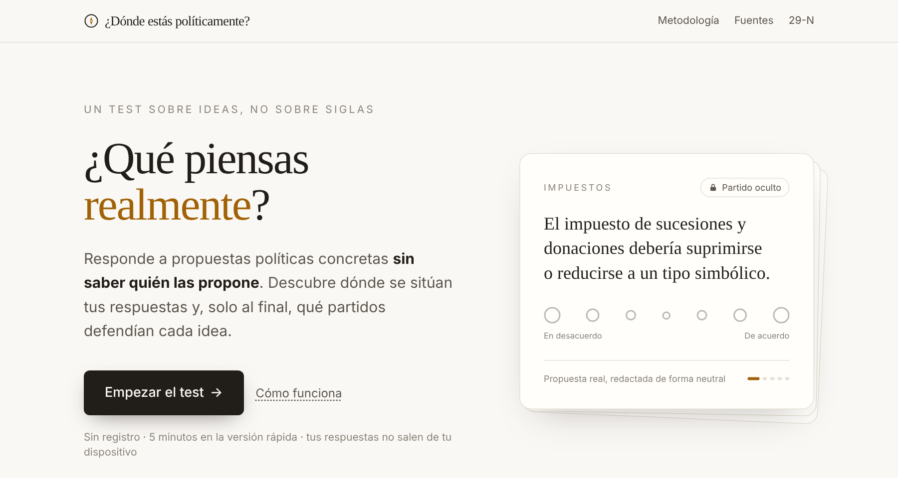
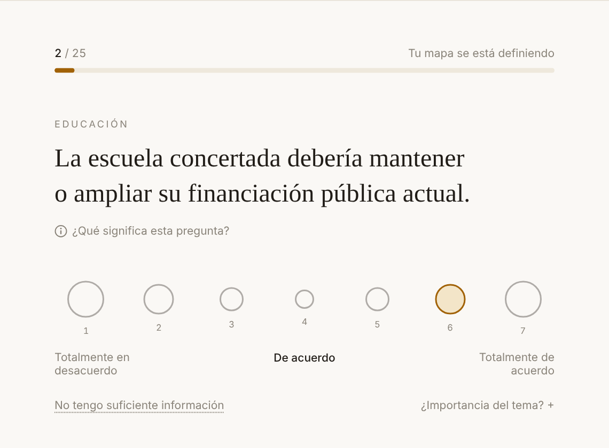
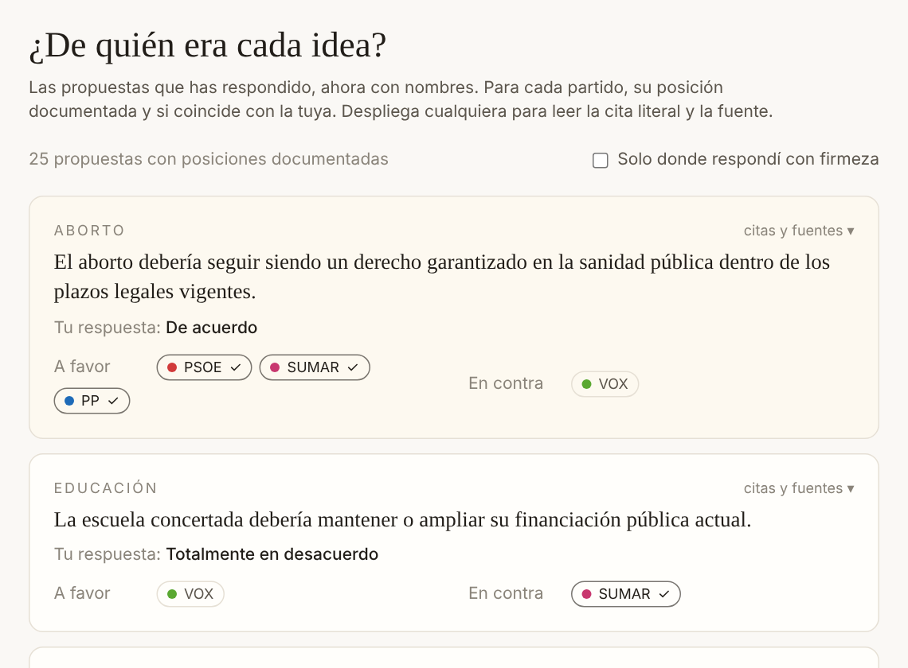

<div align="center">

# ¿Dónde estás políticamente?

**Un test político a ciegas: juzgas propuestas reales sin saber quién las propone.**

[](https://github.com/acoidaan/political-quest/actions/workflows/ci.yml)
[](LICENSE)
[](https://nextjs.org)

[**Hacer el test →**](https://political-quest.vercel.app) ·
[Metodología](https://political-quest.vercel.app/metodologia) ·
[Fuentes](https://political-quest.vercel.app/fuentes) ·
[Programas del 29-N](https://political-quest.vercel.app/elecciones)



</div>

---

En política, la marca llega antes que la idea: sabemos qué opinar de una
propuesta en cuanto sabemos quién la firma. Este proyecto invierte el orden.

1. **Respondes a propuestas concretas** sacadas de programas electorales y
   votaciones del Congreso, reescritas con lenguaje neutral. Ninguna sigla,
   color ni fecha delata su origen.
2. **Ves tu mapa en siete ejes** independientes (economía, sociedad, autoridad,
   territorio, Europa, inmigración y medioambiente), cada uno con su margen de
   incertidumbre.
3. **Al final, si quieres, se levanta el velo**: predices con qué partido
   coincidirás más y descubres, propuesta a propuesta, quién defendía cada
   idea, con la cita literal y la fuente.

<table>
<tr>
<td></td>
<td></td>
</tr>
</table>

## Metodología, en corto

Todo el detalle está en [`/metodologia`](https://political-quest.vercel.app/metodologia)
(para cualquier lector) y en [docs/ARQUITECTURA.md](docs/ARQUITECTURA.md)
(técnico).

- **Ejes por contenido, no por partidos.** Cada propuesta tiene pesos en los
  siete ejes asignados con una rúbrica escrita, solo a partir de lo que dice.
  La puntuación ideológica **nunca** usa posiciones de partidos: la
  comparación es una capa aparte y opcional.

  $$\text{eje}_a = \frac{\sum_i (r_i/3)\, w_{ia}\, \text{imp}_i}{\sum_i |w_{ia}|\, \text{imp}_i}$$

- **Incertidumbre siempre visible.** Error estándar ponderado con tamaño
  muestral efectivo de Kish y un suelo para que dos respuestas no den una
  certeza ficticia. Las respuestas contradictorias amplían el margen; nunca
  penalizan.
- **«No tengo suficiente información» no es un 0**: excluye la pregunta.
- **Similitud pregunta a pregunta**, no distancia global:
  `acuerdo = 1 − |r/3 − p| / 2`, ponderado por importancia y por la confianza
  de la fuente. Un partido sin posición documentada en una pregunta no compite
  en ella.
- **Izquierda-derecha** como combinación documentada de ejes de contenido
  (territorio y Europa quedan fuera porque en España atraviesan ese eje).

## Datos y fuentes

| | |
|---|---|
| Propuestas | 90, con redacción neutral y explicación de ambas caras |
| Posiciones con cita literal | 218 (programa, página y fragmento, o registro de votación) |
| Fuentes | Programas oficiales del 23J-2023 de PP, PSOE, VOX y Sumar; votaciones del Congreso; BOE |
| Ausencia de evidencia | Se registra como `insufficient_evidence` y no puntúa |

Regla dura: **nunca** se inventan URLs, páginas, citas ni posiciones. Las
posiciones se **versionan por fecha** (`validFrom` / `validUntil`): cuando un
partido publica un programa nuevo, la posición anterior se cierra y la nueva
entra en vigor, sin borrar la historia.

### Elecciones generales del 29-N

Las elecciones del 29 de noviembre de 2026 están convocadas. La página
[`/elecciones`](https://political-quest.vercel.app/elecciones) sigue el estado
del programa de cada candidatura, y una revisión periódica propone por pull
request la incorporación de cada programa en cuanto se publica, siguiendo
[docs/ACTUALIZACION.md](docs/ACTUALIZACION.md). Cada cambio queda en
[`/novedades`](https://political-quest.vercel.app/novedades) y en el historial
del repositorio.

## Principios innegociables

1. Durante el test, cero pistas de procedencia (partido, color, documento, fecha).
2. El scoring ideológico usa solo el **contenido** de las propuestas.
3. «No tengo suficiente información» excluye la pregunta.
4. Toda puntuación lleva su incertidumbre; la inconsistencia la amplía, nunca penaliza.
5. Un partido sin posición documentada en una pregunta no compite en ella.
6. Privacidad por diseño: cálculo local, sin registro, sin rastreadores.
7. Datasets demo y verificado separados; el build falla si se mezclan.

## Desarrollo

Requiere Node.js 20.9 o superior.

```bash
npm ci
npm run dev            # http://localhost:3000
npm test               # tests del motor de puntuación (Vitest)
npm run balance        # informe de balance y sesgo del dataset
npm run check          # lint + tipos + tests + balance + build (igual que la CI)
```

```
src/lib/scoring/          motor puro y testado: ejes, izquierda-derecha,
                          incertidumbre, consistencia, similitud, selección,
                          versionado de posiciones
src/data/questions/       dataset verificado (verified/) y fixture demo (demo/)
src/data/parties.ts       partidos en la comparación
src/data/elections.ts     seguimiento de programas del 29-N
src/data/changelog.ts     registro público de cambios (/novedades)
src/app/                  páginas (Next.js App Router)
tests/scoring/            tests unitarios del motor
docs/                     arquitectura y protocolo de actualización
```

## Contribuir

¿Una posición mal atribuida, una pregunta poco neutral o un programa que falta?
Abre un [issue](../../issues/new/choose) o lee [CONTRIBUTING.md](CONTRIBUTING.md).
Toda corrección de datos necesita fuente primaria.

## Licencia

Código bajo [licencia MIT](LICENSE). Las citas de programas y documentos
oficiales pertenecen a sus autores y se reproducen con fines de análisis.
